# Redesign: before and after

How this rebuild redesigns [rtionline.gov.in](https://rtionline.gov.in) visually and in its flows. "Before" is the real portal (public pages only, captured October 2026); "after" is this site with the v4 "Bright civic" look (gradients, Poppins headings, illustrations). Spec: [SPEC.md, Version 3](../../SPEC.md#version-3-redesign-october-2026).

## What changed

1. **Look:** colours, type and controls follow [UX4G 3.0](https://ux4g.gov.in/), the Government of India's design system (indigo and saffron, Noto Sans with Devanagari, 44px tap targets). Contrast meets WCAG AA in light and dark. There's no emblem or official branding: a top bar says the site is unofficial.
2. **Phones:** the real portal has no mobile layout. Here the header is one row and citizens get a bottom tab bar: Home, File, My requests, Help.
3. **Home page:** visitors see two main actions and "How it works" in four steps. Signed-in citizens see "Needs your action" first: a fee to pay, a document to upload, a reply to read, or an appeal that's due.
4. **Filing in two steps:** Write, then Review and pay. The authority picker sits under the request text, and "Pay ₹10 and file" opens the card page directly.
5. **Case page:** a progress bar (Filed → With officer → Reply → Appeal → Decided), the days left on the reply clock, and the next step pinned on screen.
6. **Authority picker:** 25 central authorities across 17 ministries. Six Popular chips select in one click, and "Browse all" groups the list by ministry and searches names, ministries and topics, Hindi included. The real portal lists 2,925 authorities with no search.
7. **Text size:** A− / A / A+, remembered, with no flash on load.
8. **English | हिन्दी:** the citizen interface in Hindi, chosen from the top bar and remembered.

## Clicks for common jobs

Counted from the home page, typing not counted. The 6-click filing path is checked by an automated test.

| Job | rtionline.gov.in | This site |
|---|---|---|
| File and pay (saved card) | Menu → tick 21 rules → Submit → long form → Submit → Make payment → gateway | 6 |
| Check status | Menu → registration number, email, CAPTCHA → emailed OTP, on every visit | 0 (on the home page) |
| Pay an additional fee | Separate login, then find the request | 4 (2 to the card form) |
| File a first appeal | Menu → tick rules → registration number, email, CAPTCHA → OTP → form | 1, then the form |

## Home page

| Before | After |
|---|---|
| 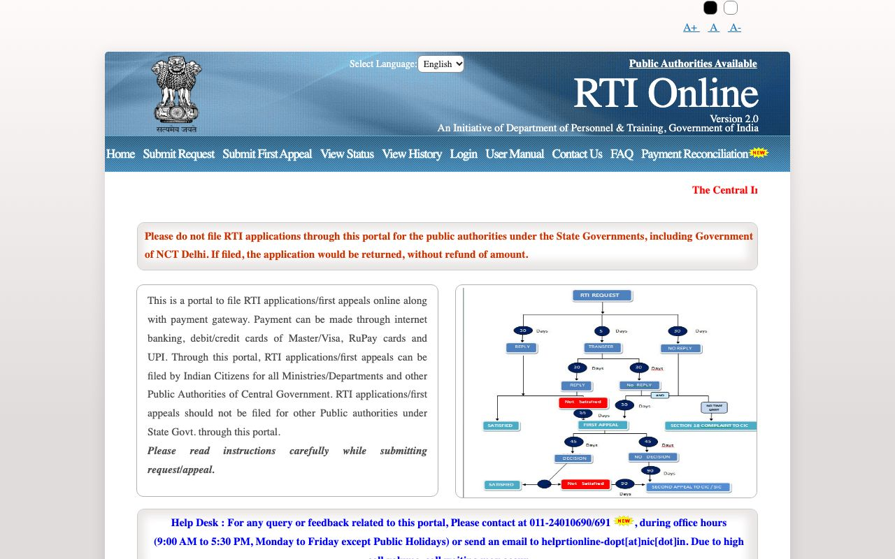 | 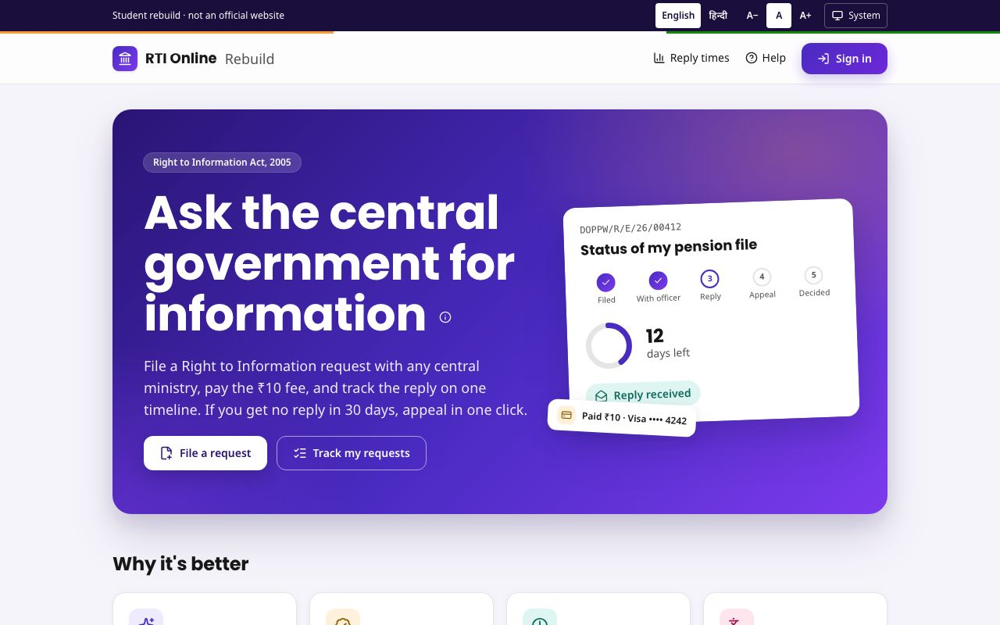 |

Signed in, the home page leads with what needs doing:

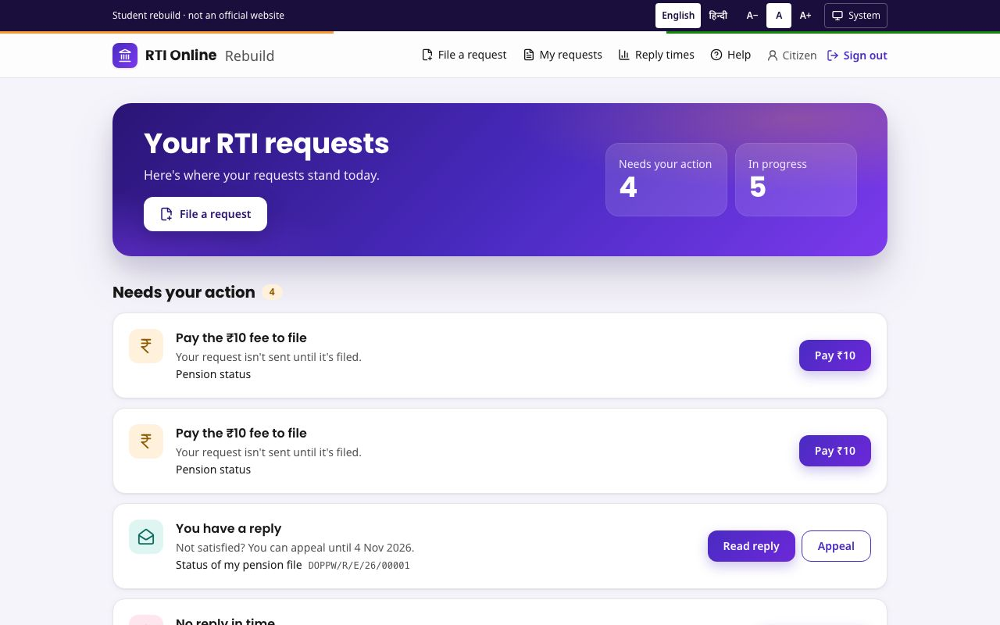

## On a phone

| Before | After | After, in Hindi |
|---|---|---|
| 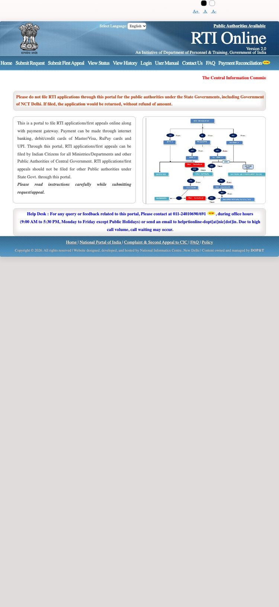 | 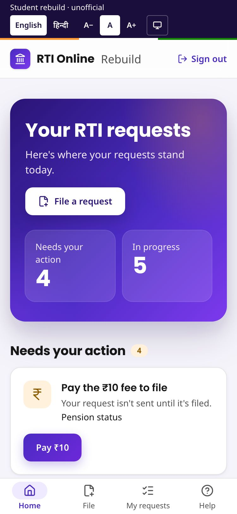 | 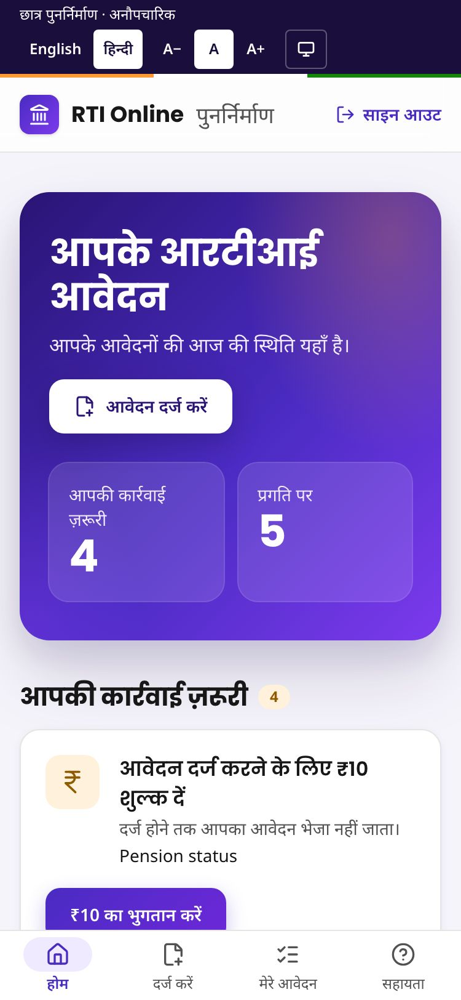 |

## Filing a request

| Before: 21 rules and a checkbox before the form | After: one page to write and pick the authority |
|---|---|
| 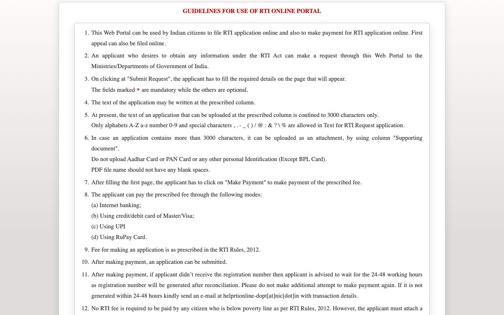 | 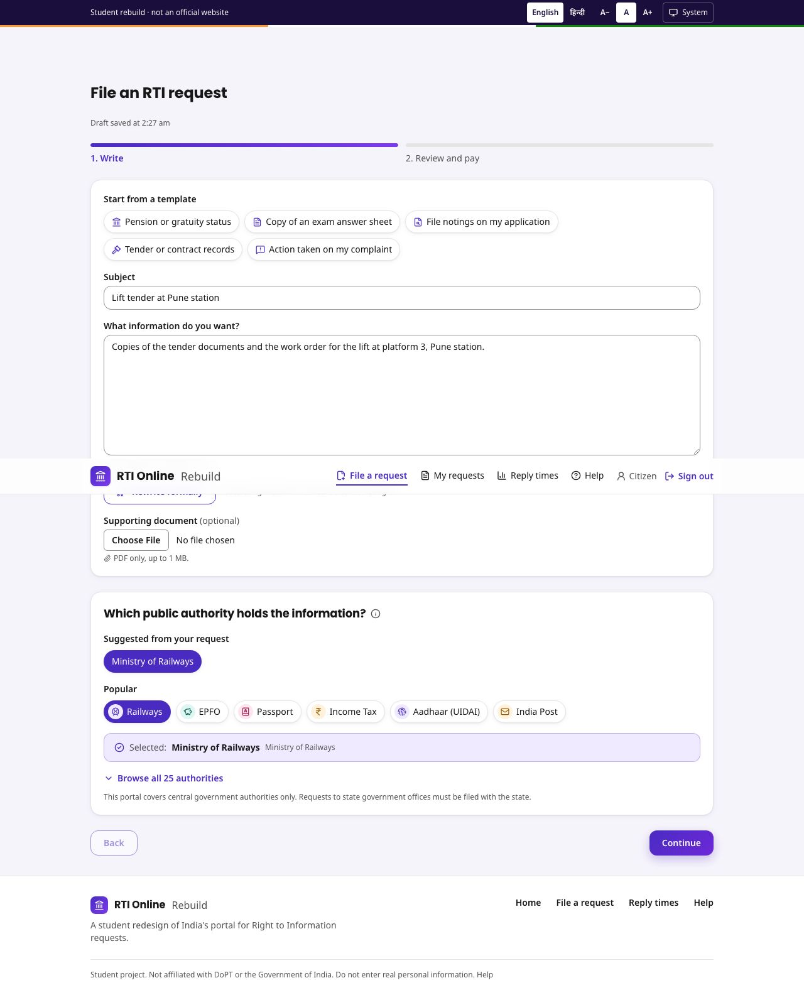 |

## Choosing the authority

| Before: 2,925 entries, no search | After: Popular chips and a grouped, searchable list |
|---|---|
| 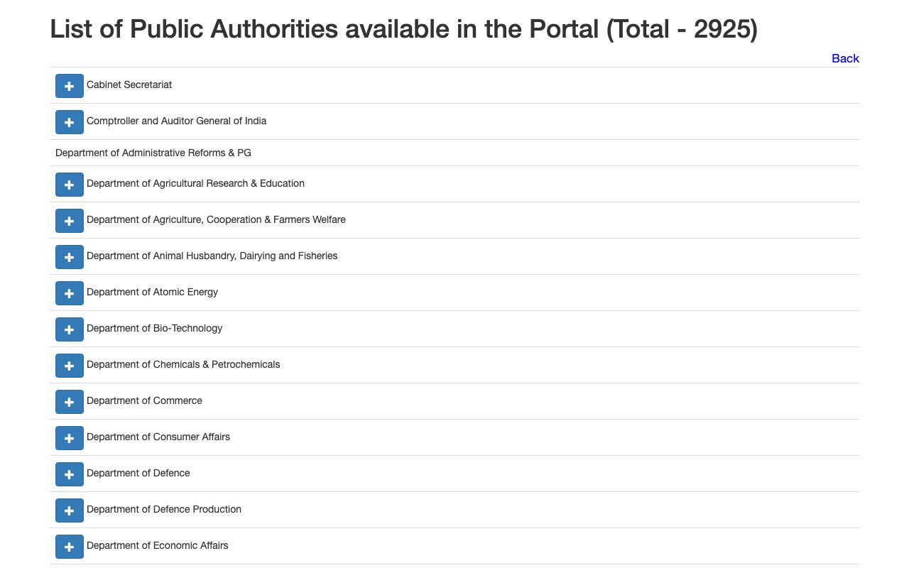 | (see the filing page above) |

## Status and the case page

| Before: CAPTCHA and OTP on every visit | After: the case page, with progress and the next step |
|---|---|
| 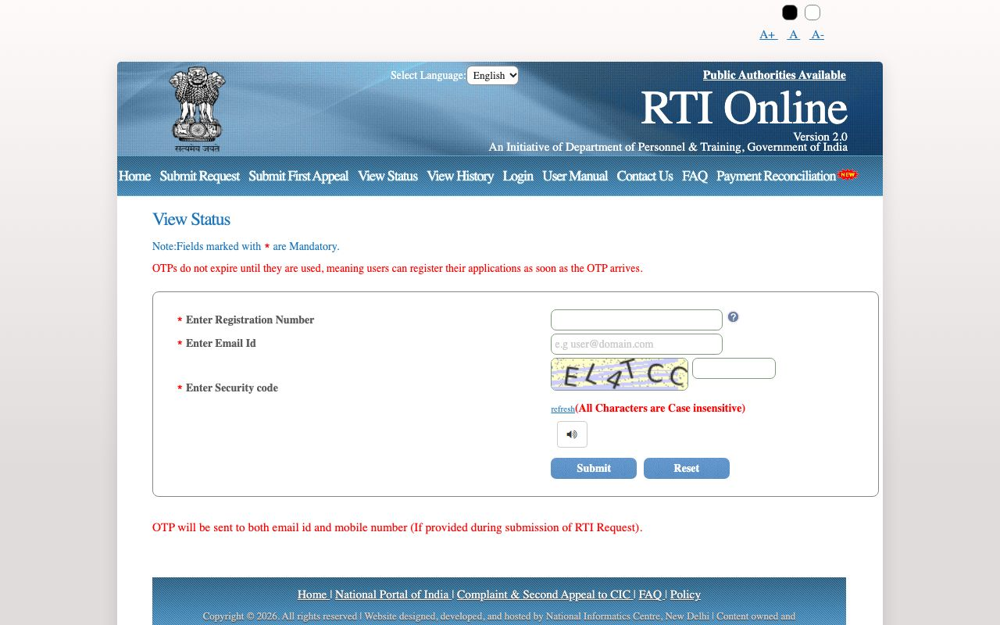 | 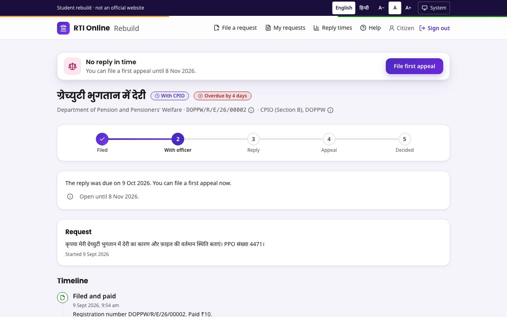 |

| After, on a phone |
|---|
| 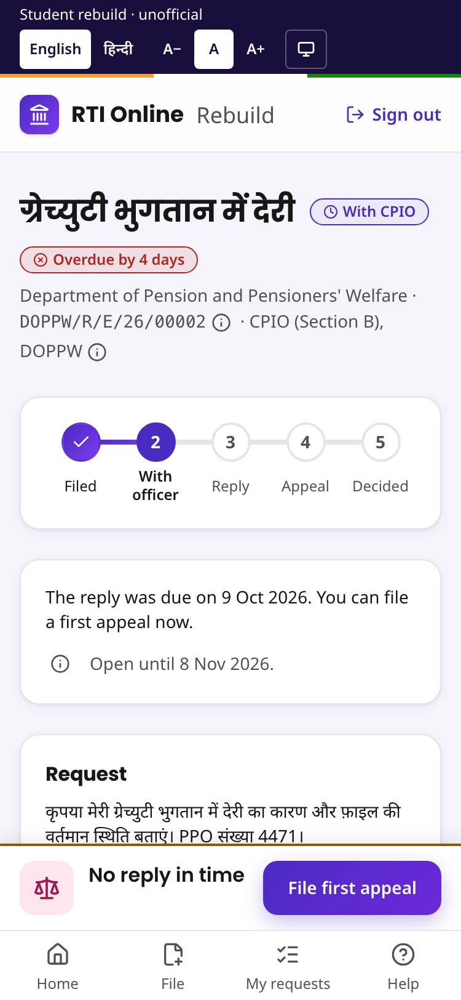 |

## First appeal

The appeal opens already filled in from the request, with the suggested ground selected:

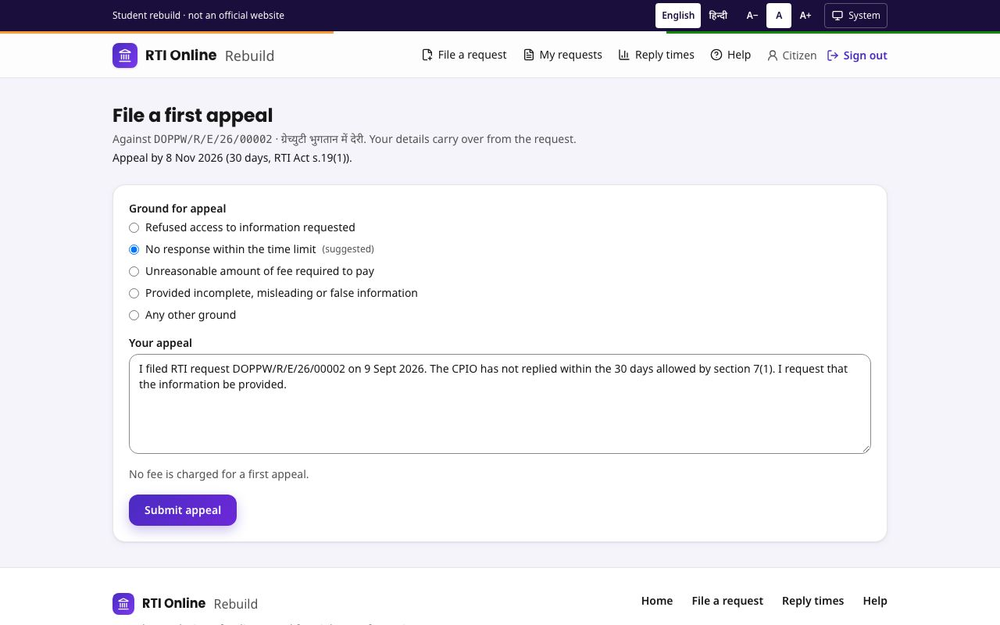

## New features

| AI rewrite (a real Gemini answer) | Card checkout | Timeline |
|---|---|---|
| 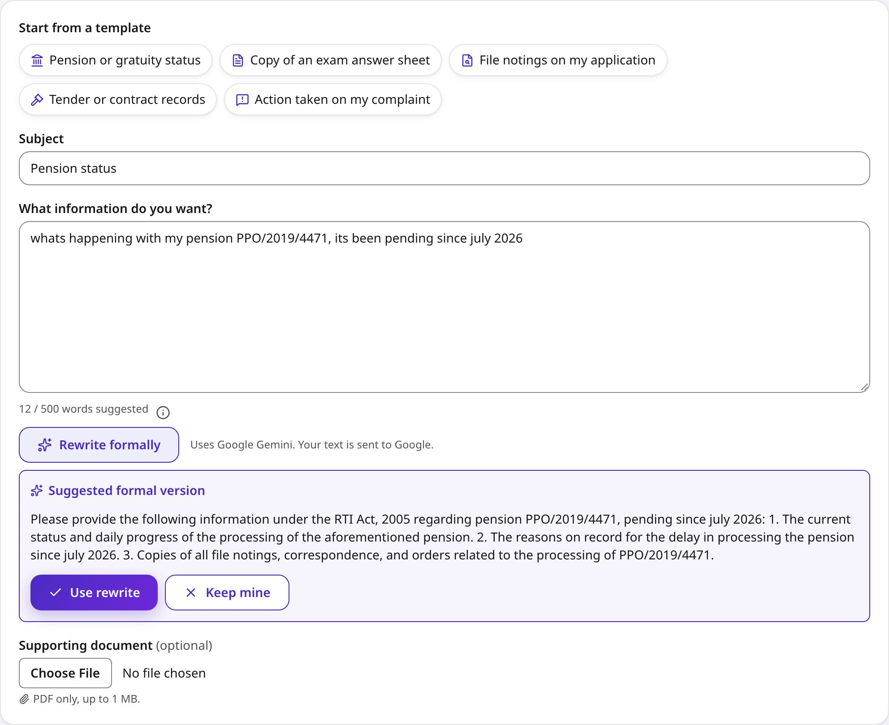 | 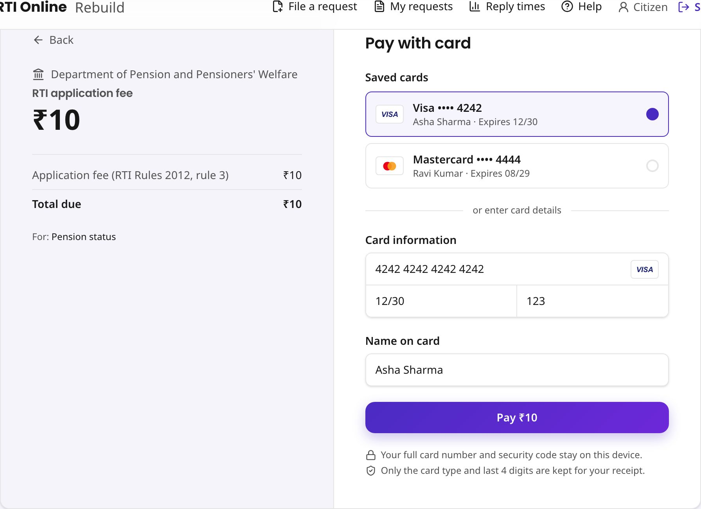 | 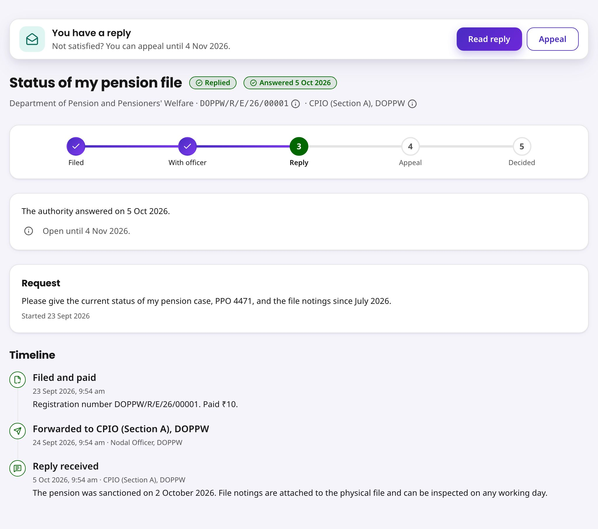 |

## Regenerating the screenshots

```bash
npx tsx --env-file=.env.local scripts/seed-demo.ts
```

Run that once with the server stopped. Then start `npm run start -- -p 3100` and run `npx tsx scripts/capture-redesign.ts`. The script only opens public pages of the real portal: it never submits a form or ticks a box.
